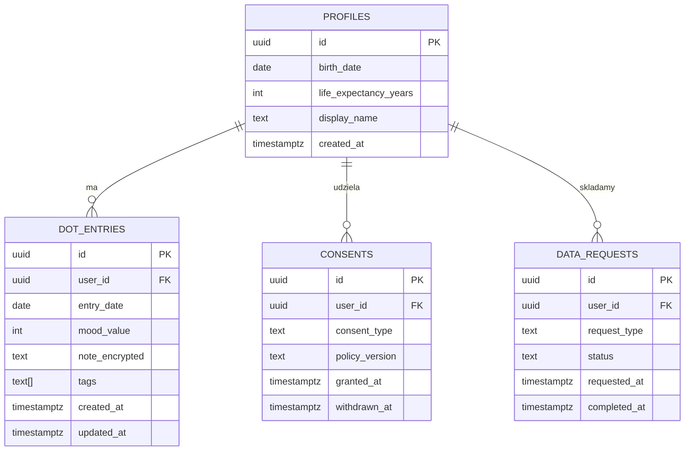

# LifeDots — Specyfikacja funkcjonalna MVP

Status: v0.1 (draft do zamrożenia przed startem implementacji)

## 1. Cel produktu

LifeDots to aplikacja webowa, która wizualizuje życie użytkownika jako siatkę "dotów"
(domyślnie: **jeden dot = jeden tydzień życia**, w stylu "Life in Weeks"), gdzie każdy
dot można oznaczyć kolorem/statusem odzwierciedlającym nastrój lub dopisać krótką notatkę
o wydarzeniu. Cel: samorefleksja, "intentional living", świadomość przemijania czasu.

## 2. Zakres MVP (in scope)

- Rejestracja/logowanie (e-mail+hasło, Google OAuth)
- Ekran onboardingu: data urodzenia + oczekiwana długość życia (domyślnie 90 lat, edytowalna)
- Siatka życia: renderowanie dotów per tydzień od narodzin do `life_expectancy_years`
  - dot przeszły bez wpisu = szary/neutralny
  - dot przeszły z wpisem = kolor wg `mood_value`
  - dot przyszły = jasny/pusty
  - dot "dziś" = wyróżniony obrys
- Kliknięcie na dot (przeszły/dzisiejszy) otwiera panel wpisu:
  - wybór nastroju (skala 1–5 lub 5 kolorów, np. 😞😐🙂😄🤩)
  - opcjonalna notatka tekstowa (max 500 znaków)
  - opcjonalne tagi (np. "praca", "rodzina", "zdrowie") — max 3
- Zapis/edycja/usunięcie pojedynczego wpisu
- Widok "dziennik" — lista wpisów chronologicznie, z filtrem po tagu/nastroju
- Ekran zgody (consent) na przetwarzanie danych o nastroju/zdrowiu — wyświetlany
  obligatoryjnie przed pierwszym wpisem, patrz [DPIA](./dpia.md) i
  [Polityka prywatności](./legal/privacy-policy.md)
- Ustawienia konta:
  - podgląd/wycofanie zgody
  - eksport danych (JSON/CSV) — samoobsługowy
  - usunięcie konta i wszystkich danych — samoobsługowe, natychmiastowe
- Funkcja "Udostępnij siatkę" — generuje obrazek PNG samej siatki (kolory dotów,
  **bez treści notatek i tagów**) do udostępnienia w social media
- Landing page (marketing, publiczna, bez logowania)

## 3. Poza zakresem MVP (out of scope — backlog v2+)

- Analityka nastroju (wykresy trendów, korelacje tagów)
- Przypomnienia/powiadomienia push
- Aplikacja mobilna natywna
- Import danych z innych aplikacji (Apple Health, dzienniki)
- Współdzielenie siatki z innymi użytkownikami (np. terapeutą)
- Płatności/subskrypcja (Stripe) — przygotowane architektonicznie, ale flaga funkcji
  wyłączona do potwierdzenia modelu monetyzacji po beta-teście

## 4. Model freemium (docelowy, poza pierwszym MVP, ale zaplanowany w danych)

| Plan | Cena | Zakres |
|---|---|---|
| Free | 0 zł | Siatka + wpisy bez limitu czasu wstecz, eksport JSON/CSV, udostępnianie obrazka |
| Pro (v2) | ~15–25 zł/mies. | Backup w chmurze z historią wersji, eksport PDF "album życia", własne palety kolorów, tagi bez limitu |

W MVP wszystkie funkcje są darmowe — walidujemy retencję i wartość produktu przed
wprowadzeniem płatności.

## 5. Model danych (referencyjny — patrz też `supabase/migrations`)

## 6. Kluczowe user flows

1. **Onboarding:** signup → ekran zgody na dane o nastroju (opt-in, wyraźny) →
   data urodzenia → wygenerowanie siatki
2. **Codzienny wpis:** dashboard → klik na dot "dziś" → wybór nastroju + notatka →
   zapis (notatka szyfrowana przed wysyłką)
3. **Eksport:** ustawienia → "Eksportuj moje dane" → generacja JSON/CSV → download
4. **Usunięcie konta:** ustawienia → "Usuń konto" → potwierdzenie → trwałe usunięcie
   wszystkich wierszy użytkownika (dot_entries, consents, profile) + unieważnienie sesji
5. **Udostępnianie:** dashboard → "Udostępnij siatkę" → render canvas → download PNG /
   Web Share API

## 7. Metryki sukcesu MVP

- Aktywacja: % użytkowników, którzy dodają ≥1 wpis w ciągu 24h od rejestracji
- Retencja D7 / D30
- Liczba udostępnień siatki / liczba aktywnych użytkowników (viral coefficient)
- NPS / feedback z beta-testu (patrz [plan beta-testu](./marketing/beta-launch-plan.md))
